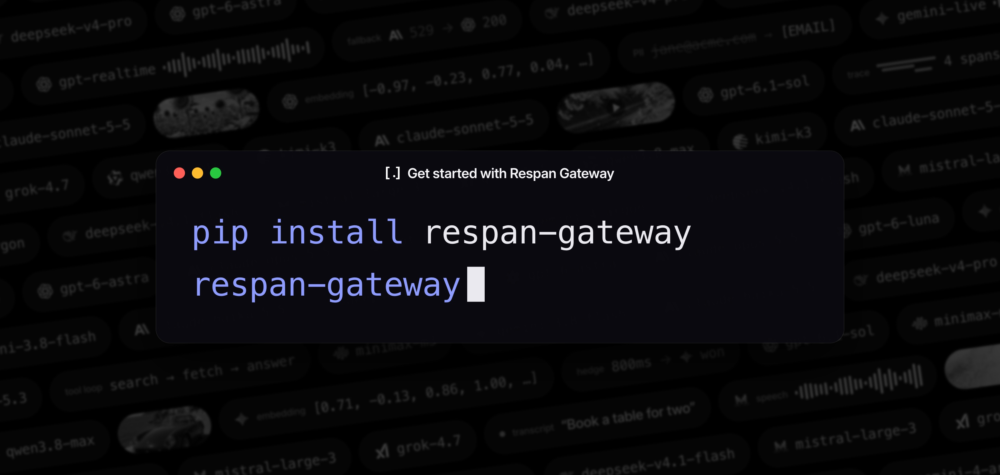
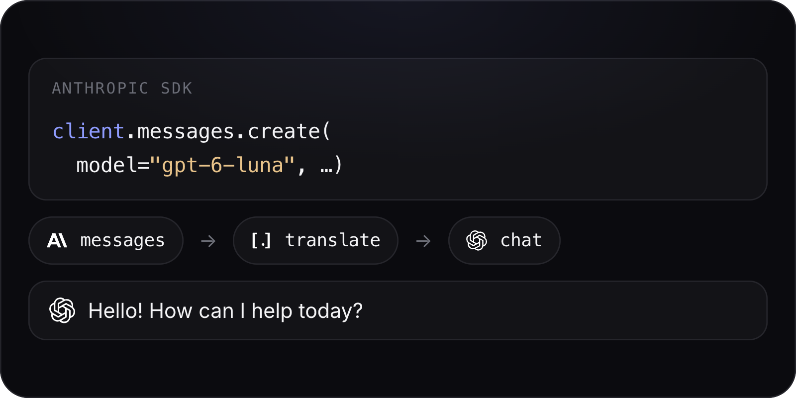
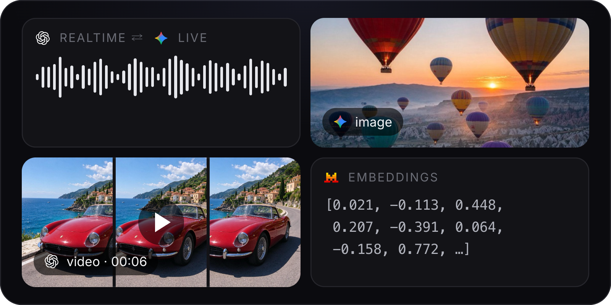
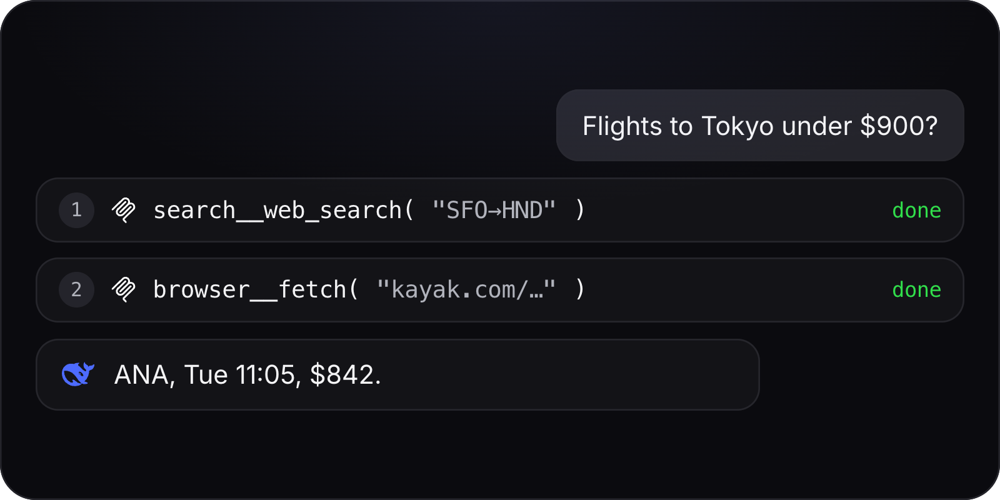
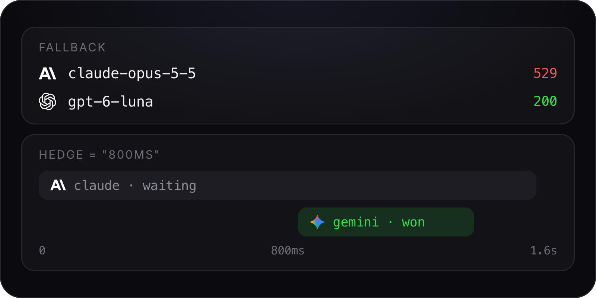
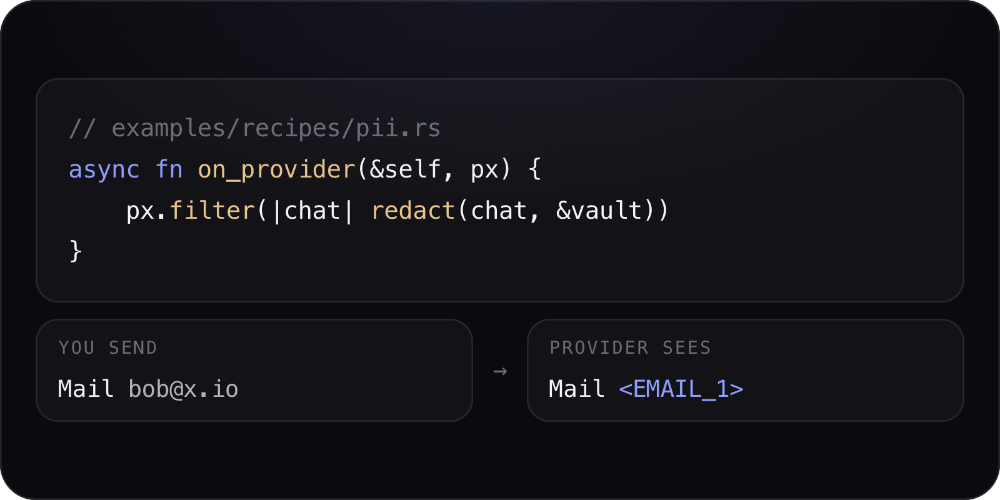
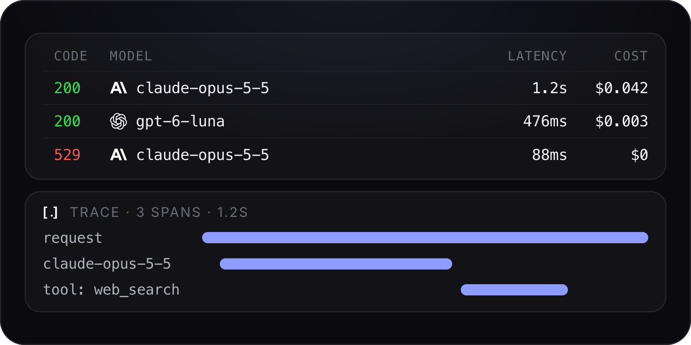

<div align="center">
  <a href="https://www.respan.ai">
    <picture>
      <source media="(prefers-color-scheme: dark)" srcset="docs/assets/respan-wordmark-dark.svg">
      
    </picture>
  </a>

  <h3>Respan Gateway: one universal adapter for AI.</h3>

  <p>
    <a href="https://www.ycombinator.com/companies/respan"></a>
    <a href="https://pypi.org/project/respan-gateway/"></a>
    <a href="https://crates.io/crates/respan-gateway"></a>
    <a href="#license"></a>
    <a href="https://discord.com/invite/KEanfAafQQ"></a>
  </p>

  <p>
    <a href="#quickstart"><b>Quickstart</b></a> ·
    <a href="https://www.respan.ai/docs/oss-gateway/introduction"><b>Docs</b></a> ·
    <a href="https://www.respan.ai/models"><b>Hosted models</b></a> ·
    <a href="https://gateway.respan.ai"><b>Endpoints</b></a> ·
    <a href="https://www.youtube.com/watch?v=pVv2ibXiTXM"><b>▶ Demo</b></a>
  </p>
</div>

**Respan Gateway** is an open-source AI gateway: a single Rust binary between
your code and every AI API. Not just LLMs: chat, realtime voice, images,
video, speech, embeddings and tools, from every major provider. Point the SDK
you already use at it, and call any of them, with fallback, tools and a live
log of every call built in.

<p align="center">
  
</p>

## Features

<table>
<tr>
<td width="55%" valign="middle">

### Keep your SDK, call any model

OpenAI, Anthropic and Gemini clients can all call any chat model. Streaming, tools, images and reasoning are translated both ways.

[Docs →](docs/vendors.md)

</td>
<td width="45%"></td>
</tr>
<tr>
<td width="55%" valign="middle">

### Multimodal

Realtime voice (OpenAI Realtime ⇄ Gemini Live), images, video, speech, transcription and embeddings, through the same gateway and the SDKs you already use.

[Docs →](docs/vendors.md)

</td>
<td width="45%"></td>
</tr>
<tr>
<td width="55%" valign="middle">

### Server-side tools

Put MCP servers or built-in tools (web search, browsers, code sandboxes, memory) behind the gateway. It runs the tool loop server side, so any model can use them from a plain chat call.

[Docs →](docs/mcp.md)

</td>
<td width="45%"></td>
</tr>
<tr>
<td width="55%" valign="middle">

### Built-in fallback and retries

A failed call falls back to the next provider, with retries and backoff. Hedged requests race a slow provider against the next one. Pick the first, cheapest or fastest.

[Docs →](docs/configuration.md)

</td>
<td width="45%"></td>
</tr>
<tr>
<td width="55%" valign="middle">

### Your own plugin in minutes

One trait, four hooks: a plugin is a few lines of Rust, on the same API every built-in feature uses. Start from a recipe: guardrails, PII masking, billing or an LLM judge.

[Docs →](docs/plugins.md)

</td>
<td width="45%"></td>
</tr>
<tr>
<td width="55%" valign="middle">

### Built-in observability

Telemetry is built in: the web UI logs every call's cost, latency and tokens, and with a Respan key every request is traced in [Respan](https://respan.ai).

[Docs →](docs/configuration.md)

</td>
<td width="45%"></td>
</tr>
</table>

## Quickstart

**1. Install**

```bash
pip install respan-gateway
```

<details>
<summary>Other ways to install</summary>

| | |
|---|---|
| Shell script | `curl -fsSL https://raw.githubusercontent.com/respanai/respan-gateway/main/install.sh \| sh` |
| Cargo | `cargo install respan-gateway` |
| Docker | `docker run -p 8080:8080 -e OPENAI_API_KEY -e RESPAN_CLIENT_KEYS=<your key> ghcr.io/respanai/respan-gateway` |
| Binaries | [GitHub releases](https://github.com/respanai/respan-gateway/releases) for macOS, Linux and Windows |
| Inside Python | [Run it in-process](python/README.md), with no server |
| Inside Rust | [Mount it in your own service](docs/plugins.md#in-a-gateway-of-your-own) |

</details>

**2. Run it with a provider key**

```bash
export OPENAI_API_KEY=sk-...
respan-gateway
```

No config file needed: every provider whose key is set is ready. No provider
keys? One [Respan key](https://www.respan.ai/models) (`RESPAN_API_KEY`) reaches
every hosted model. The web UI is at [localhost:8080/ui/](http://localhost:8080/ui/).

**3. Call any model from the SDK you already use**

```python
from anthropic import Anthropic

client = Anthropic(base_url="http://localhost:8080", api_key="unused")
reply = client.messages.create(
    model="gpt-6-luna",
    max_tokens=256,
    messages=[{"role": "user", "content": "Hello!"}],
)
print(reply.content[0].text)
```

The real provider keys stay in the gateway, so `api_key` can be anything.

## Configuration

No config file is needed to start. When you want more, one `gateway.toml` sets
up keys, providers, routing, tools and tracing (`respan-gateway init` writes a
starter one):

```toml
# ── Client keys ───────────────────────────────────────────────────
client_keys = [{ name = "app", key = "env:APP_KEY" }]   # who may call the gateway

# ── Providers ─────────────────────────────────────────────────────
[providers.anthropic]                 # a built-in vendor: just add its key
vendor = "anthropic"
key    = "env:ANTHROPIC_API_KEY"

[providers.openai]
vendor = "openai"
key    = "env:OPENAI_API_KEY"

# ── Routes ────────────────────────────────────────────────────────
[routes.smart]                        # fallback: Claude, then GPT, each tried twice
to    = ["anthropic/claude-haiku-5-5", "openai/gpt-6-luna"]
tries = 2

# ── Tools ─────────────────────────────────────────────────────────
[tools.web]                           # search and browse as MCP tools, for any model
vendor = "tinyfish"
key    = "env:TINYFISH_API_KEY"

# ── Observability ─────────────────────────────────────────────────
[plugins.respan]                      # a trace per request in Respan
key = "env:RESPAN_API_KEY"
```

<details>
<summary>Hedge a slow provider</summary>

```toml
[routes.fast]                         # start GPT if Claude is 200ms late
to    = ["anthropic/claude-haiku-5-5", "openai/gpt-6-luna"]
hedge = "200ms"
```

</details>
<details>
<summary>Pick the cheapest model</summary>

```toml
[routes.cheap]                        # the cheapest candidate that can call tools
to    = ["openai/gpt-6-luna", "anthropic/claude-haiku-5-5"]
pick  = "cheapest"                    # or first, fastest, weighted, random
needs = ["tools"]
```

</details>
<details>
<summary>Any OpenAI-compatible endpoint</summary>

```toml
[providers.local]                     # vLLM, LM Studio, your own server...
formats  = ["openai-chat"]
base_url = "http://localhost:8000/v1"
```

</details>
<details>
<summary>An MCP server, with the tool loop</summary>

```toml
[tools.github]                        # any MCP server over HTTP
url  = "https://api.githubcopilot.com/mcp/"
auth = { bearer = "env:GITHUB_TOKEN" }

[plugins.tool_loop]                   # the gateway runs the tool calls for any model
allow     = ["github__search_*"]
max_steps = 8
```

</details>

Every option: [configuration docs](https://www.respan.ai/docs/oss-gateway/introduction) and the commented [`gateway.example.toml`](gateway.example.toml).

## Works with your SDK

Every SDK, agent framework and coding agent that lets you set a base URL works
with the gateway: point it at the gateway and keep your code. How to set it in
each one is in one place, so you don't have to dig through each tool's docs.

| Client | Base URL |
|---|---|
| OpenAI SDK (Chat Completions, Responses) | `http://localhost:8080/v1` |
| Anthropic SDK | `http://localhost:8080` |
| Google GenAI | `http://localhost:8080` |

**LLM SDKs:** [OpenAI SDK](https://www.respan.ai/docs/integrations/gateway/open-ai-sdk) · [Anthropic SDK](https://www.respan.ai/docs/integrations/gateway/anthropic-sdk) · [Google GenAI](https://www.respan.ai/docs/integrations/gateway/google-gen-ai) · [LiteLLM](https://www.respan.ai/docs/integrations/gateway/lite-llm)<br>
**Agent frameworks:** [Vercel AI SDK](https://www.respan.ai/docs/integrations/gateway/vercel-ai-sdk) · [LangChain](https://www.respan.ai/docs/integrations/gateway/lang-chain) · [OpenAI Agents](https://www.respan.ai/docs/integrations/gateway/open-ai-agents) · [Claude Agent SDK](https://www.respan.ai/docs/integrations/gateway/claude-agent-sdk) · [Pydantic AI](https://www.respan.ai/docs/integrations/gateway/pydantic-ai)<br>
**Coding agents:** [Claude Code](https://www.respan.ai/docs/integrations/gateway/claude-code) · [Codex CLI](https://www.respan.ai/docs/integrations/gateway/codex-cli) · [Cursor](https://www.respan.ai/docs/integrations/gateway/cursor) · [Gemini CLI](https://www.respan.ai/docs/integrations/gateway/gemini-cli) · [OpenCode](https://www.respan.ai/docs/integrations/gateway/open-code)

[All other setup guides →](https://www.respan.ai/docs/integrations/gateway/overview)

**Guides:** [Use GPT, Gemini and any other model in Claude Desktop](examples/guides/claude-desktop/README.md)

## Providers and tools

**Model providers**: 32 built in, plus any OpenAI-compatible endpoint. [What each supports →](docs/vendors.md)

<table>
<tr><td><picture><source media="(prefers-color-scheme: dark)" srcset="docs/assets/vendors/respan-dark.svg"></picture>&nbsp;Respan</td><td><picture><source media="(prefers-color-scheme: dark)" srcset="docs/assets/vendors/openai-dark.svg"></picture>&nbsp;OpenAI</td><td><picture><source media="(prefers-color-scheme: dark)" srcset="docs/assets/vendors/anthropic-dark.svg"></picture>&nbsp;Anthropic</td><td>&nbsp;Gemini</td></tr>
<tr><td><picture><source media="(prefers-color-scheme: dark)" srcset="docs/assets/vendors/openrouter-dark.svg"></picture>&nbsp;OpenRouter</td><td>&nbsp;Azure</td><td>&nbsp;Amazon&nbsp;Bedrock</td><td><picture><source media="(prefers-color-scheme: dark)" srcset="docs/assets/vendors/xai-dark.svg"></picture>&nbsp;xAI</td></tr>
<tr><td>&nbsp;Mistral</td><td>&nbsp;Qwen</td><td>&nbsp;DeepSeek</td><td><picture><source media="(prefers-color-scheme: dark)" srcset="docs/assets/vendors/deepinfra-dark.svg"></picture>&nbsp;DeepInfra</td></tr>
<tr><td>&nbsp;Together</td><td>&nbsp;Fireworks</td><td><picture><source media="(prefers-color-scheme: dark)" srcset="docs/assets/vendors/baseten-dark.svg"></picture>&nbsp;Baseten</td><td>&nbsp;Perplexity</td></tr>
<tr><td>&nbsp;MiniMax</td><td><picture><source media="(prefers-color-scheme: dark)" srcset="docs/assets/vendors/zai-dark.svg"></picture>&nbsp;Z.ai</td><td>&nbsp;Cloudflare</td><td><picture><source media="(prefers-color-scheme: dark)" srcset="docs/assets/vendors/ollama-dark.svg"></picture>&nbsp;Ollama</td></tr>
<tr><td>&nbsp;vLLM</td><td>&nbsp;EmpirioLabs&nbsp;AI</td><td>&nbsp;StepFun</td><td><picture><source media="(prefers-color-scheme: dark)" srcset="docs/assets/vendors/primeintellect-dark.png"></picture>&nbsp;Prime&nbsp;Intellect</td></tr>
<tr><td><picture><source media="(prefers-color-scheme: dark)" srcset="docs/assets/vendors/morph-dark.svg"></picture>&nbsp;Morph</td><td>&nbsp;DeepRelay</td><td>&nbsp;TypeSafe</td><td><picture><source media="(prefers-color-scheme: dark)" srcset="docs/assets/vendors/phonic-dark.svg"></picture>&nbsp;Phonic</td></tr>
<tr><td><picture><source media="(prefers-color-scheme: dark)" srcset="docs/assets/vendors/groq-dark.svg"></picture>&nbsp;Groq</td><td><picture><source media="(prefers-color-scheme: dark)" srcset="docs/assets/vendors/cerebras-dark.svg"></picture>&nbsp;Cerebras</td><td><picture><source media="(prefers-color-scheme: dark)" srcset="docs/assets/vendors/concentrate-dark.svg"></picture>&nbsp;Concentrate</td><td>&nbsp;OpenCode&nbsp;Zen</td></tr>
</table>

**Tools**: any MCP server, plus 14 built-in tool vendors any model can use. [All tools →](docs/tool-vendors.md)

<table>
<tr><td>&nbsp;Tavily</td><td>&nbsp;Exa</td><td><picture><source media="(prefers-color-scheme: dark)" srcset="docs/assets/tool-vendors/linkup-dark.svg"></picture>&nbsp;Linkup</td><td>&nbsp;Firecrawl</td></tr>
<tr><td>&nbsp;Browserbase</td><td>&nbsp;TinyFish</td><td>&nbsp;Apify</td><td>&nbsp;E2B</td></tr>
<tr><td><picture><source media="(prefers-color-scheme: dark)" srcset="docs/assets/tool-vendors/daytona-dark.png"></picture>&nbsp;Daytona</td><td>&nbsp;Context7</td><td>&nbsp;Reducto</td><td>&nbsp;Zep</td></tr>
<tr><td><picture><source media="(prefers-color-scheme: dark)" srcset="docs/assets/tool-vendors/elevenlabs-dark.svg"></picture>&nbsp;ElevenLabs</td><td>&nbsp;Cloudinary</td></tr>
</table>

**Your own**: anything missing is a plugin away, on the same Rust API every built-in feature uses. Start from the [plugin guide](docs/plugins.md) or a recipe: [guardrails](examples/recipes/guardrail.rs) · [PII masking](examples/recipes/pii.rs) · [billing](examples/recipes/billing.rs) · [LLM judge](examples/recipes/judge.rs) · [fallback](examples/recipes/fallback.rs) · [MCP proxy](examples/recipes/mcp_proxy.rs) · [all examples →](examples/README.md)

## Performance

| | Respan Gateway | Bifrost | Portkey | LiteLLM (1 worker) |
|---|---:|---:|---:|---:|
| Added latency (p50) | **0.07 ms** | 0.16 ms | 0.17 ms | 4.34 ms |
| Throughput | **56,734/s** | 18,182/s | 4,187/s | 268/s |
| Memory | **31 MB** | 488 MB | 350 MB | 418 MB |
| 1k streams, success | **100%** | 92–100% | — | 79% |
| p99 with 5% slow calls | **105 ms** | 2,002 ms | 2,003 ms | 2,024 ms |

## Community

- Questions and ideas: [Discord](https://discord.com/invite/KEanfAafQQ) or [Discussions](https://github.com/respanai/respan-gateway/discussions)
- Missing a provider or feature? [Open an issue](https://github.com/respanai/respan-gateway/issues/new/choose)
- Want to contribute? Read [CONTRIBUTING.md](CONTRIBUTING.md) and pick a [good first issue](https://github.com/respanai/respan-gateway/labels/good%20first%20issue). A new provider is usually one file.
- Security issues: see [SECURITY.md](SECURITY.md)

Thank you to everyone who has contributed to Respan Gateway:

<a href="https://github.com/respanai/respan-gateway/graphs/contributors">
  
</a>

## Respan managed gateway

Respan runs the same gateway for you at [gateway.respan.ai](https://gateway.respan.ai).

- One key for every [hosted model](https://www.respan.ai/models)
- Up to 55% off tokens, 0% fee
- [Get an API key →](https://respan.ai/ai-gateway)

## License

[MIT](LICENSE-MIT) or [Apache-2.0](LICENSE-APACHE), at your option.
