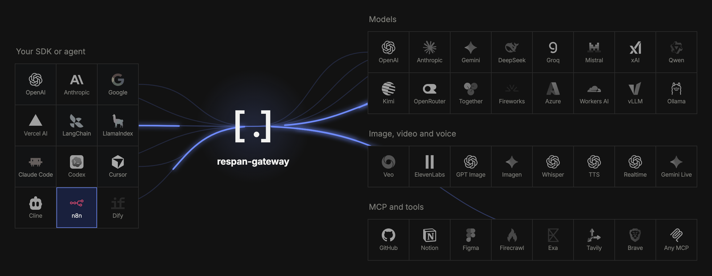

<div align="center">
  <a href="https://www.respan.ai">
    <picture>
      <source media="(prefers-color-scheme: dark)" srcset="docs/assets/wordmark-dark.png">
      
    </picture>
  </a>
  <p><b>The universal adapter for AI.</b></p>
  <div>
    <a href="#license"></a>
    <a href="https://github.com/respanai/respan-gateway/actions/workflows/ci.yml"></a>
    <a href="https://github.com/respanai/respan-gateway/releases"></a>
    <a href="https://crates.io/crates/respan-gateway"></a>
    <a href="https://pypi.org/project/respan-gateway/"></a>
    <a href="https://discord.com/invite/KEanfAafQQ"></a>
  </div>
</div>
<br>

**Respan Gateway** is a single Rust binary that sits between your code and
every AI API. Point the SDK you already use at it, and it connects you to
everything: chat models, images, video and voice from every major provider;
tools for any model, from web search and memory to code sandboxes and any MCP
server; and traffic control (format translation, fallback, retries and hedged
requests), with a live log of every call. **[▶ Watch the demo](https://www.youtube.com/watch?v=pVv2ibXiTXM)**

<br>
<div align="center">
  
</div>
<br>

## Key features

- **Any client, any model**<br>
  OpenAI Chat Completions, OpenAI Responses, Anthropic Messages and Gemini API
  clients can all call any model, with streaming, tools,
  images and reasoning translated.

- **Multimodal**<br>
  Realtime voice across vendors (an OpenAI Realtime client talks to Gemini
  Live, and back), plus images, speech, transcription, embeddings and video
  through OpenAI's or Gemini's APIs, to any vendor that has them.

- **MCP tools for every model**<br>
  Put MCP servers or built-in tool vendors behind the gateway, from web search
  to code sandboxes. It runs their tools inside chat requests, so a plain chat
  call can use them, whatever the client or model.

- **Traffic control**<br>
  Named routes, globs and `provider/model`; fallback, retries, cheapest or
  fastest; and hedged requests that race a slow call against a second
  provider.

- **Observability**<br>
  A live request log with cost, latency and tokens for every call, and traces
  in [Respan](https://respan.ai), where span-02 analyzes how your agents
  behave.

- **Best-in-class performance**<br>
  0.07 ms of added latency, 56,000 requests per second and 31 MB of memory in
  our benchmarks: about 3× the throughput of the next
  fastest gateway we tested.

- **Write your own plugin in minutes**<br>
  Every feature above is a plugin, built on the same public Rust API you can
  use: one trait with four hooks. Start from the [plugin guide](docs/plugins.md)
  or an [example](examples/README.md) such as guardrails, PII masking or
  billing.

## Quickstart

**1. Install**

```bash
pip install respan-gateway
```

Or `cargo install respan-gateway`, or a
[GitHub release](https://github.com/respanai/respan-gateway/releases).

**2. Run it with your keys**

```bash
export OPENAI_API_KEY=sk-...
respan-gateway
```

No config file needed: every vendor whose key is set becomes a provider.

**3. Call any model from any SDK**

```python
from anthropic import Anthropic

client = Anthropic(base_url="http://localhost:8080", api_key="unused")
reply = client.messages.create(
    model="gpt-6-luna", max_tokens=256,
    messages=[{"role": "user", "content": "Hello from the Anthropic SDK"}])
print(reply.content[0].text)
```

The web UI is at [localhost:8080/ui/](http://localhost:8080/ui/). Next:
[configuration](docs/configuration.md) and [MCP tools](docs/mcp.md).

### Other ways to run it

- [Python, in-process](python/README.md) — Run the gateway inside your Python app, with no server.
- [Embed in Rust](docs/plugins.md#in-a-gateway-of-your-own) — Mount the gateway in your own Rust service.
- [Docker](Dockerfile) — Run the image `ghcr.io/respanai/respan-gateway` on any container host.

## Performance

| | Respan Gateway | Bifrost | Portkey | LiteLLM (1 worker) |
|---|---:|---:|---:|---:|
| Added latency (p50) | **0.07 ms** | 0.16 ms | 0.17 ms | 4.34 ms |
| Throughput | **56,734/s** | 18,182/s | 4,187/s | 268/s |
| Memory | **31 MB** | 488 MB | 350 MB | 418 MB |
| 1k streams, success | **100%** | 92–100% | — | 79% |
| 1k streams, memory | **128 MB** | 688 MB | — | 493 MB |
| p99, 5% slow calls | **105 ms** | 2,002 ms | 2,003 ms | 2,024 ms |

## Configuration

You don't need a config file to start. When you want more, run
`respan-gateway init` for a commented `gateway.toml`. One file sets up keys,
providers, traffic control, tools and tracing:

```toml
client_keys = [{ name = "app", key = "env:APP_KEY" }]   # who may call the gateway

[providers.openai]                      # a built-in vendor: just add a key
vendor = "openai"
key = "env:OPENAI_API_KEY"

[providers.anthropic]
vendor = "anthropic"
key = "env:ANTHROPIC_API_KEY"

[providers.local]                       # any OpenAI-compatible endpoint
formats = ["openai-chat"]
base_url = "http://localhost:8000/v1"

[routes.smart]                          # clients ask for "model": "smart"
to = ["anthropic/claude-haiku-5-5", "openai/gpt-6-luna"]
hedge = "800ms"                         # race the second if the first is slow

[tools.search]                          # web search as MCP tools
vendor = "linkup"
key = "env:LINKUP_API_KEY"

[plugins.tool_loop]                     # every model can use them
servers = ["search"]

[plugins.respan]                        # trace every call in Respan
key = "env:RESPAN_API_KEY"
```

`respan-gateway check` validates it, and `--watch` or `SIGHUP` reloads it
without a restart. Without client keys, the gateway answers only on loopback
and refuses to start on a public address.

**Reference:** [configuration](docs/configuration.md) ·
[vendors](docs/vendors.md) · [tool vendors](docs/tool-vendors.md) ·
[MCP and tools](docs/mcp.md) · [`gateway.example.toml`](gateway.example.toml)

## Supported API formats

Call the gateway in any format on the left, and it reaches every provider on
the right, translating between them.

| | Your code calls | It can reach |
|---|---|---|
| **Chat** | OpenAI Chat Completions<br>OpenAI Responses<br>Anthropic Messages<br>Gemini API | <picture><source media="(prefers-color-scheme: dark)" srcset="docs/assets/vendors/openai-dark.svg"></picture> <picture><source media="(prefers-color-scheme: dark)" srcset="docs/assets/vendors/anthropic-dark.svg"></picture>  <picture><source media="(prefers-color-scheme: dark)" srcset="docs/assets/vendors/xai-dark.svg"></picture>   <picture><source media="(prefers-color-scheme: dark)" srcset="docs/assets/vendors/groq-dark.svg"></picture> <picture><source media="(prefers-color-scheme: dark)" srcset="docs/assets/vendors/openrouter-dark.svg"></picture>   <picture><source media="(prefers-color-scheme: dark)" srcset="docs/assets/vendors/ollama-dark.svg"></picture><br>any chat model, whichever of the four formats it speaks |
| **Realtime voice** | OpenAI Realtime<br>Gemini Live | <picture><source media="(prefers-color-scheme: dark)" srcset="docs/assets/vendors/openai-dark.svg"></picture>  <br>OpenAI ⇄ Gemini voice; Mistral for transcription |
| **Images** | OpenAI Images<br>Gemini Images | <picture><source media="(prefers-color-scheme: dark)" srcset="docs/assets/vendors/openai-dark.svg"></picture>  <picture><source media="(prefers-color-scheme: dark)" srcset="docs/assets/vendors/xai-dark.svg"></picture>   |
| **Speech, transcription** | OpenAI Speech<br>OpenAI Transcriptions<br>Gemini Speech and Transcriptions (providers only) | <picture><source media="(prefers-color-scheme: dark)" srcset="docs/assets/vendors/openai-dark.svg"></picture> <picture><source media="(prefers-color-scheme: dark)" srcset="docs/assets/vendors/groq-dark.svg"></picture>   |
| **Embeddings** | OpenAI Embeddings | <picture><source media="(prefers-color-scheme: dark)" srcset="docs/assets/vendors/openai-dark.svg"></picture>       <picture><source media="(prefers-color-scheme: dark)" srcset="docs/assets/vendors/ollama-dark.svg"></picture> |
| **Video** | OpenAI Videos<br>Gemini Veo<br>Vertex AI Veo (providers only) |  Google Veo |
| **Decisions** | Respan Decisions<br>TypeSafe System One | <picture><source media="(prefers-color-scheme: dark)" srcset="docs/assets/vendors/respan-dark.svg"></picture>  |
| **Tools** | MCP | <picture><source media="(prefers-color-scheme: dark)" srcset="docs/assets/vendors/mcp-dark.svg"></picture> your MCP servers and tool vendors |
| **Anything else** | A vendor's own API | Relayed to that vendor untouched |

Each vendor's formats are in [vendors](docs/vendors.md), and the translation
details in each format's README: [chat](crates/formats/conversation-http/README.md),
[media](crates/formats/media-http/README.md),
[realtime](crates/formats/realtime-ws/README.md) and
[decisions](crates/formats/decision-http/README.md).

## Plugins

Everything the gateway does is a plugin on one public Rust API.

**Models** · 16 providers and any compatible endpoint, each reachable from any client format. [All vendors →](docs/vendors.md)

<p>
  <picture><source media="(prefers-color-scheme: dark)" srcset="docs/assets/vendors/openai-dark.svg"></picture>&nbsp;&nbsp;<picture><source media="(prefers-color-scheme: dark)" srcset="docs/assets/vendors/anthropic-dark.svg"></picture>&nbsp;&nbsp;&nbsp;&nbsp;<picture><source media="(prefers-color-scheme: dark)" srcset="docs/assets/vendors/xai-dark.svg"></picture>&nbsp;&nbsp;&nbsp;&nbsp;&nbsp;&nbsp;<picture><source media="(prefers-color-scheme: dark)" srcset="docs/assets/vendors/groq-dark.svg"></picture>&nbsp;&nbsp;<picture><source media="(prefers-color-scheme: dark)" srcset="docs/assets/vendors/openrouter-dark.svg"></picture>&nbsp;&nbsp;&nbsp;&nbsp;&nbsp;&nbsp;&nbsp;&nbsp;&nbsp;&nbsp;&nbsp;&nbsp;&nbsp;&nbsp;<picture><source media="(prefers-color-scheme: dark)" srcset="docs/assets/vendors/ollama-dark.svg"></picture>&nbsp;&nbsp;
</p>

**Tools** · any MCP server, plus built-in tools for search, browsing, code, documents and memory, usable from any model. [All tool vendors →](docs/tool-vendors.md)

<p>
  <picture><source media="(prefers-color-scheme: dark)" srcset="docs/assets/tool-vendors/linkup-dark.svg"></picture>&nbsp;&nbsp;&nbsp;&nbsp;&nbsp;&nbsp;&nbsp;&nbsp;&nbsp;&nbsp;&nbsp;&nbsp;<picture><source media="(prefers-color-scheme: dark)" srcset="docs/assets/tool-vendors/daytona-dark.png"></picture>&nbsp;&nbsp;&nbsp;&nbsp;&nbsp;&nbsp;&nbsp;&nbsp;&nbsp;&nbsp;<picture><source media="(prefers-color-scheme: dark)" srcset="docs/assets/tool-vendors/elevenlabs-dark.svg"></picture>
</p>

**Traffic control** · named routes, fallback, retries, hedged requests, and the cheapest or fastest provider.

**Observability** · a live request log, the cost of every call, and traces in [Respan](https://respan.ai).

**Your framework** · anything with a base URL. Guides for the [OpenAI SDK](https://www.respan.ai/docs/integrations/gateway/open-ai-sdk), [Anthropic SDK](https://www.respan.ai/docs/integrations/gateway/anthropic-sdk), [Google GenAI](https://www.respan.ai/docs/integrations/gateway/google-gen-ai), [Vercel AI SDK](https://www.respan.ai/docs/integrations/gateway/vercel-ai-sdk), [LangChain](https://www.respan.ai/docs/integrations/gateway/lang-chain), [Pydantic AI](https://www.respan.ai/docs/integrations/gateway/pydantic-ai), [Pi](https://www.respan.ai/docs/integrations/gateway/pi), [OpenCode](https://www.respan.ai/docs/integrations/gateway/open-code) and [more](https://www.respan.ai/docs/integrations/gateway/overview).

**Your own plugin** · start from the [plugin guide](docs/plugins.md) or an [example](examples/README.md): guardrails, PII masking, billing, an LLM judge.

<sub>Built in: [`routing`](crates/plugins/routing/README.md) · [`tool-loop`](crates/plugins/tool-loop/README.md) · [`mcp-router`](crates/plugins/mcp-router/README.md) · [`pricing`](crates/plugins/pricing/README.md) · [`respan`](crates/plugins/respan/README.md) · [`responses`](crates/plugins/responses/README.md) · [`credentials`](crates/plugins/credentials/README.md)</sub>

## Community

Contributions are welcome. [CONTRIBUTING.md](CONTRIBUTING.md) covers the
architecture, building and tests, and a new vendor is usually one file.
Start with a
[good first issue](https://github.com/respanai/respan-gateway/labels/good%20first%20issue),
ask in [Discussions](https://github.com/respanai/respan-gateway/discussions)
or [Discord](https://discord.com/invite/KEanfAafQQ), and report security
issues as [SECURITY.md](SECURITY.md) describes.

**Roadmap:** what we're building next is in
[issues](https://github.com/respanai/respan-gateway/issues). Missing a vendor,
format or feature? [Ask for it](https://github.com/respanai/respan-gateway/issues/new/choose).

**Want it managed?** [Respan](https://respan.ai) runs the gateway for you, with
dashboards, evals and span-02.

<a href="https://github.com/respanai/respan-gateway/graphs/contributors">
  
</a>

## License

Dual-licensed under [MIT](LICENSE-MIT) or [Apache-2.0](LICENSE-APACHE), at
your option.
