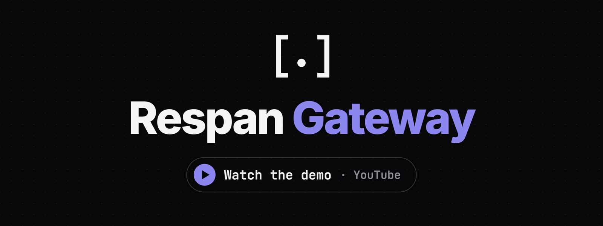

[](https://www.youtube.com/watch?v=pVv2ibXiTXM)

# Respan Gateway

One endpoint for every LLM vendor. Point any official SDK at the gateway,
name any model, and it routes the request to the right provider,
translating between OpenAI, Anthropic and Gemini APIs on the way.

- **Any client, any model.** OpenAI Chat Completions, OpenAI Responses,
  Anthropic Messages and Gemini `generateContent` clients can all call
  any model, with tools, images and reasoning translated.
- **More than chat.** Realtime voice (OpenAI Realtime ⇄ Gemini Live),
  images, speech, transcription, embeddings and video jobs. Anything else
  is relayed untouched.
- **Routing and resilience.** Named routes, globs, `provider/model`,
  fallback, retries, hedged races, and picking the cheapest or fastest.
- **MCP.** It fronts MCP servers behind your client keys. It can also run
  their tools inside chat requests for clients that know nothing of MCP.
- **Observability.** A live request log and web UI, per-call pricing, and
  traces sent to [Respan](https://respan.ai).
- **Extensible.** Every feature above is a plugin built on one public Rust
  API. See the [plugin guide](docs/plugins.md).

## Install

```bash
# Linux, macOS
curl -fsSL https://raw.githubusercontent.com/respanai/respan-gateway/main/install.sh | sh
```

```powershell
# Windows
irm https://raw.githubusercontent.com/respanai/respan-gateway/main/install.ps1 | iex
```

It is a single binary with the web UI built in. It also comes from
`cargo install respan-gateway`, as a Python package
(`pip install respan-gateway`, see [`python/`](python/README.md)), and on
each [GitHub release](https://github.com/respanai/respan-gateway/releases).

No release is tagged yet, so until the first tag, build from source: build
the UI with `cd apps/ui && pnpm install && pnpm build`, then run
`cargo build --release -p respan-gateway`.

## Quickstart

```bash
export OPENAI_API_KEY=sk-... ANTHROPIC_API_KEY=sk-ant-... GEMINI_API_KEY=...
respan-gateway
```

You don't need a config file. Every vendor whose key is in the environment
becomes a provider. The model name picks the provider, whatever API the
client speaks:

```bash
# OpenAI Chat client → Claude
curl localhost:8080/v1/chat/completions \
  -d '{"model":"claude-haiku-5-5","messages":[{"role":"user","content":"hi"}]}'

# Anthropic client → GPT
curl localhost:8080/v1/messages \
  -d '{"model":"gpt-6-luna","max_tokens":64,"messages":[{"role":"user","content":"hi"}]}'

# `provider/model` names a provider explicitly
curl localhost:8080/v1/responses -d '{"model":"groq/openai/gpt-oss-20b","input":"hi"}'
```

An SDK only needs a base URL:

```python
from openai import OpenAI
OpenAI(base_url="http://localhost:8080/v1", api_key="unused").chat.completions.create(
    model="gemini-2.5-flash", messages=[{"role": "user", "content": "hi"}])

from anthropic import Anthropic
Anthropic(base_url="http://localhost:8080", api_key="unused").messages.create(
    model="gpt-6-luna", max_tokens=64, messages=[{"role": "user", "content": "hi"}])
```

Media uses OpenAI's endpoints: `/v1/images/generations`,
`/v1/audio/transcriptions`, `/v1/audio/speech`, `/v1/embeddings` and
`/v1/videos`. `GET /v1/models` lists every provider's models, and the web UI
is at [localhost:8080/ui/](http://localhost:8080/ui/).

## Configuration

`respan-gateway init` writes a commented `gateway.toml` for client keys,
routes, custom providers, prices and plugins:

```toml
client_keys = [{ name = "app", key = "env:APP_KEY" }]

[providers.local]                       # Any OpenAI-compatible endpoint
formats = ["openai-chat"]
base_url = "http://localhost:8000/v1"

[routes.smart]                          # Clients ask for "model": "smart"
to = ["anthropic/claude-haiku-5-5", "openai/gpt-6-luna"]
```

Without client keys, the gateway answers only loopback and refuses to start
on a public address.

- [Configuration](docs/configuration.md): the command line, environment,
  providers, client keys, routing, pricing and conversation state.
- [Vendors](docs/vendors.md): every built-in vendor, its tier, key, formats
  and base URL.
- [Tool vendors](docs/tool-vendors.md): every built-in tool vendor, its
  tier, key and tools.
- [Tools](docs/mcp.md): MCP servers and tool vendors under `[tools]`, the merged `/mcp` endpoint and the tool loop.
- [`gateway.example.toml`](gateway.example.toml): a short example to start from.

## Supported APIs

| Kind | Formats |
|---|---|
| chat | `openai-chat`, `openai-responses`, `anthropic-messages`, `gemini-generate`; `passthrough` for a vendor's other endpoints |
| realtime | `openai-realtime` ⇄ `gemini-live`; `responses-ws` relayed |
| image, speech, transcription, embedding | OpenAI's endpoints |
| video | `openai-videos`, `gemini-veo` |

**Vendors:** OpenAI, Anthropic, Gemini, Respan, TypeSafe, Groq, DeepSeek,
OpenRouter, xAI, Mistral, Together, Fireworks, Ollama, Azure, vLLM and
Cloudflare, plus any compatible endpoint; see [Vendors](docs/vendors.md)
for their tiers, keys and formats. Translation details are in each
format's README, for [chat](crates/formats/conversation-http/README.md),
[media](crates/formats/media-http/README.md) and
[realtime](crates/formats/realtime-ws/README.md).

## As a library

The binary is a library, `respan_gateway`: `App::new(config)?.router()`
returns an `axum::Router`. To build your own gateway from the crates, start
with the [plugin guide](docs/plugins.md) and the [`examples/`](examples/README.md).

## Contributing

[CONTRIBUTING.md](CONTRIBUTING.md) covers the architecture, building, tests
and releases.

## License

Dual-licensed under [MIT](LICENSE-MIT) or [Apache-2.0](LICENSE-APACHE), at
your option.
