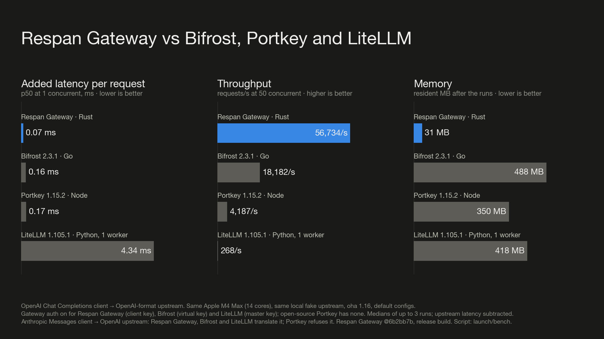

<div align="center">
  <a href="https://www.respan.ai"></a>
  <h1>Respan Gateway</h1>
  <div>
    <a href="#license"></a>
    <a href="https://github.com/respanai/respan-gateway/actions/workflows/ci.yml"></a>
    <a href="https://github.com/respanai/respan-gateway/releases"></a>
    <a href="https://crates.io/crates/respan-gateway"></a>
    <a href="https://pypi.org/project/respan-gateway/"></a>
    <a href="https://discord.com/invite/KEanfAafQQ"></a>
  </div>
  <p><b>The open-source AI gateway. Any SDK, any model, any tool.</b></p>
</div>

---

**Respan Gateway** is one Rust binary between your apps and every AI
provider. Point any official SDK at it, name any model, and it translates
the request to that provider's API: OpenAI, Anthropic and Gemini formats in
either direction, plus realtime voice, images, speech and video. It routes
with fallback and hedged races, gives every model your MCP tools, and logs
each call in a built-in UI.

<br>
<div align="center">
  
</div>
<br>

## Demo

<div align="center">
  <a href="https://www.youtube.com/watch?v=pVv2ibXiTXM">
    
  </a>
</div>

## Key features

- **Any client, any model**<br>
  OpenAI Chat Completions, OpenAI Responses, Anthropic Messages and Gemini
  `generateContent` clients can all call any model, with streaming, tools,
  images and reasoning translated.

- **Realtime voice across vendors**<br>
  An OpenAI Realtime client talks to Gemini Live, and back. Images, speech,
  transcription, embeddings and video jobs go through OpenAI's endpoints to
  any vendor that has them.

- **MCP tools for every model**<br>
  Put MCP servers or built-in tool vendors behind the gateway. It runs their
  tools inside chat requests, so a plain chat call can search the web or run
  code, whatever the client or model.

- **Routing that cuts tail latency**<br>
  Named routes, globs and `provider/model`; fallback, retries, cheapest or
  fastest; and hedged races that send a slow call to a second provider.

- **One binary, built-in UI**<br>
  A 19 MB binary with a live request log, per-call pricing and config
  reload. No database, no Python, no Docker required. Traces can go to
  [Respan](https://respan.ai).

- **Plugins on a public API**<br>
  Every feature above is a Rust plugin on the same API you can use. See the
  [plugin guide](docs/plugins.md) and the [examples](examples/README.md).

## Quickstart

**1. Install**

```bash
curl -fsSL https://raw.githubusercontent.com/respanai/respan-gateway/main/install.sh | sh
```

Or `cargo install respan-gateway`, `pip install respan-gateway`, the
[Windows installer](install.ps1), or a
[GitHub release](https://github.com/respanai/respan-gateway/releases).

**2. Run it with your keys**

```bash
export OPENAI_API_KEY=sk-... ANTHROPIC_API_KEY=sk-ant-... GEMINI_API_KEY=...
respan-gateway
```

No config file needed: every vendor whose key is set becomes a provider.

**3. Call any model from any SDK**

```python
from anthropic import Anthropic

client = Anthropic(base_url="http://localhost:8080", api_key="unused")
reply = client.messages.create(
    model="gpt-6-luna", max_tokens=256,
    messages=[{"role": "user", "content": "Hello from the Anthropic SDK"}])
print(reply.content[0].text)
```

The web UI is at [localhost:8080/ui/](http://localhost:8080/ui/). Next:
[configuration](docs/configuration.md) and [MCP tools](docs/mcp.md).

## Performance

Measured on one Apple M4 Max against a local fake upstream, default configs,
gateway auth on.

| | Respan Gateway | Bifrost | Portkey | LiteLLM |
|---|---:|---:|---:|---:|
| Added latency, p50 | **0.07 ms** | 0.16 ms | 0.17 ms | 4.34 ms |
| Throughput, 50 concurrent | **56,734/s** | 18,182/s | 4,187/s | 268/s |
| Memory | **31 MB** | 488 MB | 350 MB | 418 MB |
| p99 when 5% of calls stall 2 s | **105 ms** (hedged) | 2,002 ms | 2,003 ms | 2,024 ms |

<div align="center">
  
</div>

Versions, method and caveats are in [docs/benchmarks.md](docs/benchmarks.md).

## Integrations

**Models:** OpenAI, Anthropic, Gemini, xAI, DeepSeek, Mistral, Groq,
OpenRouter, Together, Fireworks, Cerebras, Perplexity, Azure, Cloudflare,
Ollama, vLLM and any compatible endpoint. [All vendors →](docs/vendors.md)

**Tools:** Apify, Browserbase, Cloudinary, Context7, Daytona, E2B,
ElevenLabs, Linkup, Reducto, Tavily, TinyFish and Zep, plus any MCP server.
[All tool vendors →](docs/tool-vendors.md)

## Documentation

- [Overview](docs/README.md): supported APIs, built-in plugins, using it as a library
- [Configuration](docs/configuration.md): `gateway.toml`, providers, client keys, routing, pricing
- [Vendors](docs/vendors.md) and [tool vendors](docs/tool-vendors.md)
- [MCP and tools](docs/mcp.md): MCP servers, the merged `/mcp` endpoint, the tool loop
- [Plugin guide](docs/plugins.md) and [examples](examples/README.md)

## Community

Contributions are welcome. [CONTRIBUTING.md](CONTRIBUTING.md) covers the
architecture, building and tests, and a new vendor is usually one file.
Start with a
[good first issue](https://github.com/respanai/respan-gateway/labels/good%20first%20issue),
ask in [Discussions](https://github.com/respanai/respan-gateway/discussions)
or [Discord](https://discord.com/invite/KEanfAafQQ), and report security
issues as [SECURITY.md](SECURITY.md) describes.

<a href="https://github.com/respanai/respan-gateway/graphs/contributors">
  
</a>

## License

Dual-licensed under [MIT](LICENSE-MIT) or [Apache-2.0](LICENSE-APACHE), at
your option.
