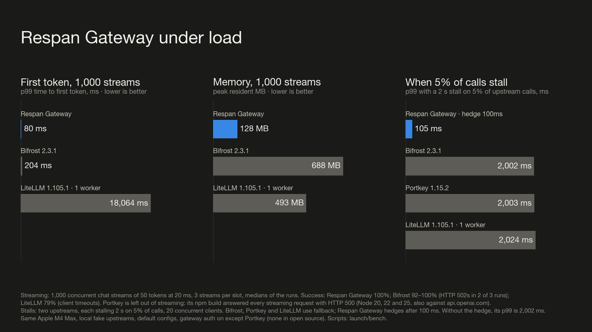

# Benchmarks

Every gateway ran on the same Apple M4 Max (14 cores) against the same local
fake OpenAI upstream, with its default configuration, one at a time. Load
came from [oha](https://github.com/hatoo/oha) 1.16.

| Gateway | Version | How it ran | Gateway auth |
|---|---|---|---|
| Respan Gateway | commit 6b2bb7b, release build | the binary | client key |
| Bifrost | 2.3.1 | its Go binary | virtual key |
| Portkey | 1.15.2 | `@portkey-ai/gateway` on Node 25 | none in open source |
| LiteLLM | 1.105.1 | the Python proxy, one worker, no database | master key |

## Overhead and throughput

OpenAI Chat Completions client → OpenAI-format upstream, the one path all
four serve. Medians of up to three runs.

| | Respan Gateway | Bifrost | Portkey | LiteLLM |
|---|---:|---:|---:|---:|
| Added latency, p50 at 1 concurrent | 0.07 ms | 0.16 ms | 0.17 ms | 4.34 ms |
| Throughput at 50 concurrent | 56,734/s | 18,182/s | 4,187/s | 268/s |
| Resident memory after the runs | 31 MB | 488 MB | 350 MB | 418 MB |

Added latency is the gateway's p50 minus calling the upstream directly.
Anthropic Messages client → OpenAI upstream: Respan Gateway, Bifrost and
LiteLLM translate it; Portkey refuses it.

## Under load

- **1,000 concurrent streams** of 50 tokens at 20 ms. Respan Gateway: 100%
  success, 80 ms p99 time to first token, 128 MB peak. Bifrost: 92–100%
  (HTTP 502s in two of three runs), 204 ms, 688 MB. LiteLLM with one
  worker: 79% (client timeouts). Portkey's npm build answered every
  streaming request with HTTP 500, on Node 20, 22 and 25.
- **A slow upstream.** Two upstreams each stall 2 s on 5% of calls, 20
  concurrent clients. With fallback, every gateway's p99 is about 2 s.
  Respan Gateway hedging after 100 ms brings it to 105 ms.
- **Failover.** With 30% of the primary's calls failing, all four reach
  100% success through fallback.

## Caveats

- LiteLLM ran as one Python worker. More workers raise its throughput
  (14 workers reached about 1,700/s on chat) at the cost of memory, and its
  `litellm_core` Rust build was not tested.
- These measure the gateway, not a provider: the fake upstream answers in
  microseconds. Real calls take hundreds of milliseconds, so overhead
  matters most at high concurrency and for memory.
- One machine, one run set. Numbers on your hardware will differ.
