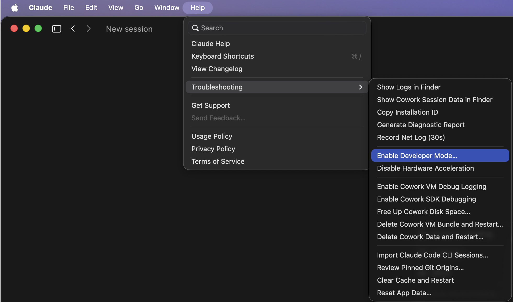
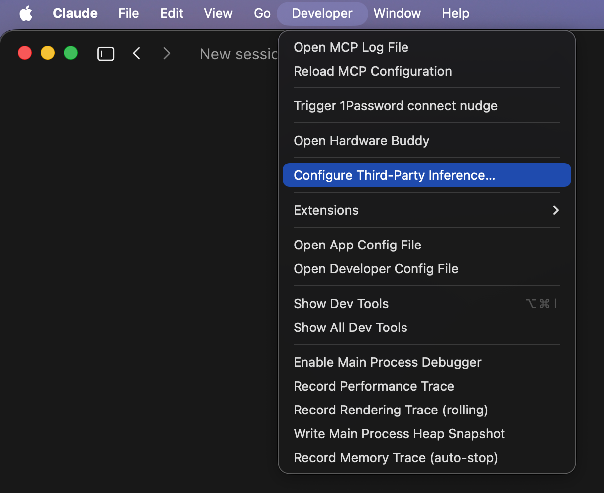
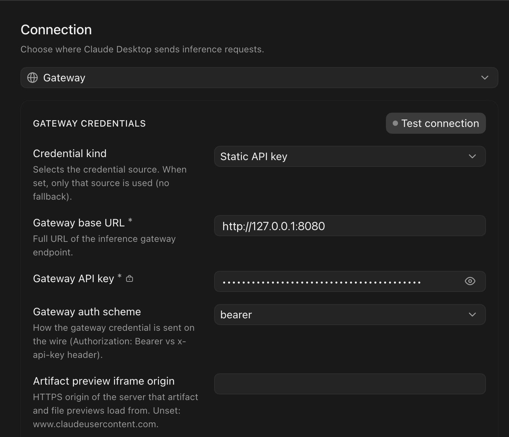
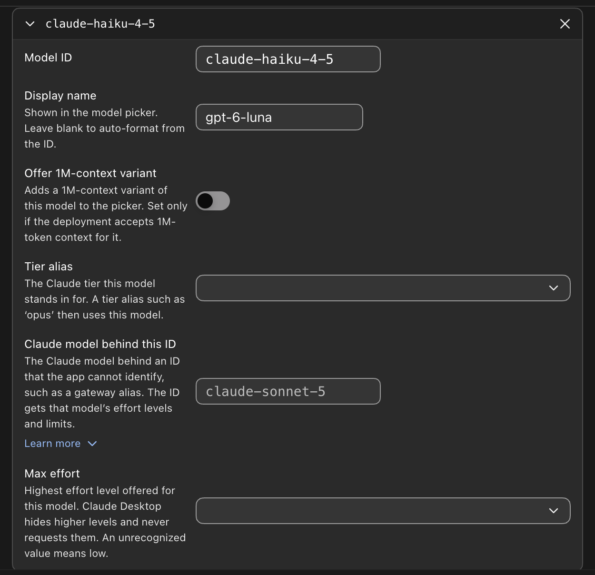

# Use GPT, Gemini and any other model in Claude Desktop

*Run Claude Desktop, chat and the Code tab, on OpenAI, Gemini or a model on
your own machine.*

In the Claude Code CLI this is easy: set `ANTHROPIC_BASE_URL` and pass any
model name. Claude Desktop is different, and this guide is about Desktop.

## Why Desktop needs a router

Claude Desktop can send its requests to your own server instead of
Anthropic's. Anthropic calls this
[third-party inference](https://claude.com/docs/third-party/claude-desktop).
But it comes with two limits:

1. **Desktop only accepts Claude model names.** Its model list expects
   Anthropic model IDs such as `claude-haiku-4-5`. Enter `gpt-6-luna` and
   it tells you it "doesn't look like an Anthropic model".
2. **Desktop only speaks the Anthropic Messages API.** OpenAI, Gemini and
   most local models speak other APIs.

So you can't point Desktop at OpenAI and pick GPT. Desktop will ask for
`claude-haiku-4-5`, in Anthropic's format, and OpenAI has no model by that
name and doesn't speak that format.

Respan Gateway sits in the middle and fixes both. A **route** takes the
Claude name Desktop asks for and sends the request to the model you chose,
translating it to that model's API on the way:

```
Claude Desktop ──"claude-haiku-4-5"──▶ Respan Gateway ──"gpt-6-luna"──▶ OpenAI
                                       route: claude-haiku-4-5 → openai/gpt-6-luna
```

You pick Claude Haiku 4.5 in Desktop, and the answer comes from
`gpt-6-luna`.

## 1. Run the gateway with a route

Install it:

```bash
pip install respan-gateway
```

Write a `gateway.toml` that gives each model a Claude name:

```toml
listen = "127.0.0.1:8080"

[providers.openai]
vendor = "openai"
key = "env:OPENAI_API_KEY"

[providers.gemini]
vendor = "gemini"
key = "env:GEMINI_API_KEY"

# Desktop asks for a Claude name; each route sends it to another model.
[routes."claude-haiku-4-5"]
to = "openai/gpt-6-luna"

[routes."claude-sonnet-4-5"]
to = "gemini/gemini-omni-1.1-flash"
```

Start it:

```bash
export OPENAI_API_KEY=sk-...
export GEMINI_API_KEY=...
respan-gateway
```

The right-hand side of a route can be any model the gateway reaches, such
as `ollama/...` for a model on your own machine. `respan-gateway models`
lists what each provider serves.

## 2. Turn on Developer Mode in Claude Desktop

The setting for third-party inference is in the Developer menu, which is
hidden until you turn on Developer Mode.

1. In the menu bar, open **Help → Troubleshooting → Enable Developer
   Mode…**
2. Confirm in the dialog. A **Developer** menu now appears in the menu bar.

<p align="center"></p>

## 3. Add the gateway as an inference provider

1. Open **Developer → Configure Third-Party Inference…**

   <p align="center"></p>

2. Under **Connection**, choose **Gateway**.
3. Fill in **Gateway credentials**:

   | Field | Value |
   |---|---|
   | Credential kind | Static API key |
   | Gateway base URL | `http://127.0.0.1:8080` |
   | Gateway API key | any text, such as `unused`. On `127.0.0.1` the gateway needs no key. If you set `client_keys`, use one of them |
   | Gateway auth scheme | `bearer` |

   Click **Test connection** to check that Desktop reaches the gateway.

   <p align="center"></p>

4. Turn **Model discovery** off, so you choose the models yourself.
5. Under **Model list**, click **Add model** once for each route. Set
   **Model ID** to the route's Claude name and **Display name** to what you
   want to see in the picker:

   | Model ID | Display name |
   |---|---|
   | `claude-haiku-4-5` | `gpt-6-luna` |
   | `claude-sonnet-4-5` | `gemini-omni-1.1-flash` |

   The **Model ID** must match a route name in `gateway.toml` exactly. You
   can leave the other fields empty.

   <p align="center"></p>

6. Save, and restart Claude when it asks.

Desktop now opens in third-party mode. In the model picker, in chat or in
the Code tab, pick **Claude Haiku 4.5**. Desktop thinks it's talking to
Haiku, but the gateway sends every message to OpenAI, and the answer you
get is from `gpt-6-luna`.

## 4. Check that it works

Open [localhost:8080/ui/](http://localhost:8080/ui/) and send a message
from Desktop. The request shows up with the model it really went to,
`gpt-6-luna`, and its tokens, cost and latency.

If a message fails, ask the gateway where a name goes:

```bash
curl "http://127.0.0.1:8080/ui/api/routes/explain?model=claude-haiku-4-5"
```

## Adding more models

Every new model is a route in `gateway.toml` and a row in Desktop's model
list. Each Claude name can stand for one model, so use a different Claude
name, such as `claude-opus-4-5`, for each model you want in the picker.

A route can also list several models: `to = ["openai/gpt-6-luna",
"gemini/gemini-omni-1.1-flash"]` falls back to Gemini when OpenAI fails.
