# From the GPU to your bill: a deep dive into prompt caching

*What a prompt cache is on the GPU, why it disappears, how providers price it, and how to stop paying for the same text twice.*

**Deep dive into caching**

- [1 - Prompt caching is now more important than anything in inference cost](#1---prompt-caching-is-now-more-important-than-anything-in-inference-cost)
- [2 - Agent cost is almost all input, and it grows faster than the session](#2---agent-cost-is-almost-all-input-and-it-grows-faster-than-the-session)
- [3 - The cache stores the model's work, not your text](#3---the-cache-stores-the-models-work-not-your-text)
- [4 - A cache is born in GPU memory, but it can't stay there long](#4---a-cache-is-born-in-gpu-memory-but-it-cant-stay-there-long)
- [5 - Guess: why Anthropic offers a 5-minute and a 1-hour cache](#5---guess-why-anthropic-offers-a-5-minute-and-a-1-hour-cache)

**How inference providers set prices**

- [6 - Cache prices are copied, not calculated](#6---cache-prices-are-copied-not-calculated)

**How to stop paying for the same text twice**

- [7 - Know what hit rate to expect](#7---know-what-hit-rate-to-expect)
- [8 - Keep the cache warm](#8---keep-the-cache-warm)
- [9 - Check your harness, not just your prompt](#9---check-your-harness-not-just-your-prompt)
- [10 - Think twice before switching models](#10---think-twice-before-switching-models)

**Cache-aware routing**

- [11 - Does your router count the cache?](#11---does-your-router-count-the-cache)

### 1 - Prompt caching is now more important than anything in inference cost

Everyone knows what prompt caching is, roughly: when you send the same prompt again, the provider reuses the work and saves you money. But not a lot of people have looked further, including me.

In the last two months, Anthropic, OpenAI and Google all brought cached input down to 5% of the normal price. And here's the math. A 60-turn coding session on Opus 5.5 costs about $28 if nothing is cached. Switching to a model at half the price brings that to 1/2, while keeping the cache warm brings it to only 1/5 to 1/8.

However, caching breaks quietly. Change a single character at the beginning of that session and your next "continue" costs a dollar instead of four cents. OpenCode users saw their bills jump overnight and traced it to a bug: at midnight, the date in the system prompt changed, and every open session re-read its whole history at full price.

In this article, I'm trying to break down caching from what happens inside the GPU to the bill: why switching to a cheaper model can make your bill go up, which coding agents quietly break their own cache, and what eviction actually looks like on an H100 I rented.

### 2 - Agent cost is almost all input, and it grows faster than the session

We know that every turn resends the whole session. Here is what that does to the numbers.

In a human conversation, input is about 7 times output. In a coding agent, it can be up to 100 times.

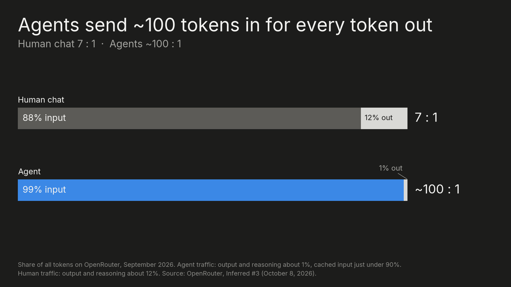

At the same time, input grows with the square of the turns in one session, because every turn resends everything before it. Each turn's prompt is a bit longer than the last, so the total keeps compounding. A 30-turn session reads about 2 million tokens, and a 60-turn one gets up to about 6.7 million. Twice the turns, 3.4 times the input.

Also, inference cost is about GPU compute time. Within one read, time grows faster than the length of the prompt. Measured on an H100:

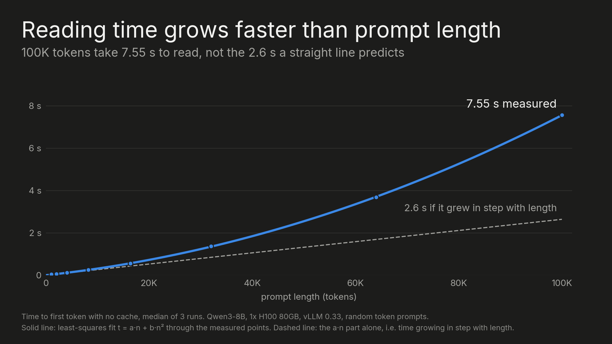

It's not even exponential; it's almost quadratic. Some providers now price that in: Haiku 5.5 costs five times as much per token above 100K, and GPT-6.1 Sol twice as much above 272K.

### 3 - The cache stores the model's work, not your text

When a model reads your prompt, it doesn't keep the words. For every token, at every layer, it works out what that token means in context and stores the result as vectors. That's the reading cost from the last section.

Each token gets three of them. A query: what am I looking for? A key: what do I contain? A value: what do I hand over if you pick me? Every token compares its query with the keys of all the tokens before it, and takes the most from the values that match. When the model reads "it", its query asks what "it" refers to, the key of "apple" a few words back matches, and "it" borrows the value of "apple".

A query is used once, while its token is being read. Keys and values are used by every token that comes after. So keys and values are what's worth keeping. That's the KV cache, and a prompt cache is just the provider keeping it between your requests. Same 100K prompt, sent twice on an H100: 7.55 seconds to read it the first time, 0.14 seconds the second.

Three facts about the cache explain most of what happens in the rest of this article:

**Only the beginning can be reused.** Every token's key and value depend on everything before it, so changing one token invalidates everything after it. I changed a single token in a cached 32K prompt, at different positions:

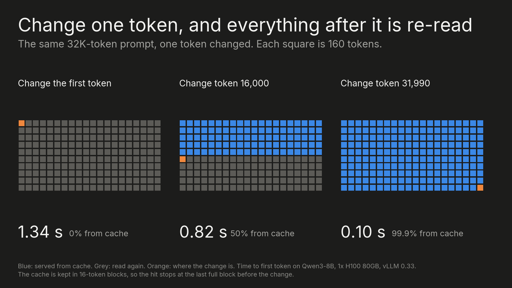

**The cache belongs to one model.** Keys and values come out of that model's weights, so another model can't use them. Switch models mid-session and the new one reads everything from scratch. [Anthropic](https://platform.claude.com/docs/en/build-with-claude/cache-diagnostics), [OpenAI](https://developers.openai.com/api/docs/guides/prompt-caching) and [Google](https://aistudio.google.com/api-reference/caching) all say so in their docs.

**The cache is really big.** It grows with every token in the session, and for a long session it can take up most of a GPU:

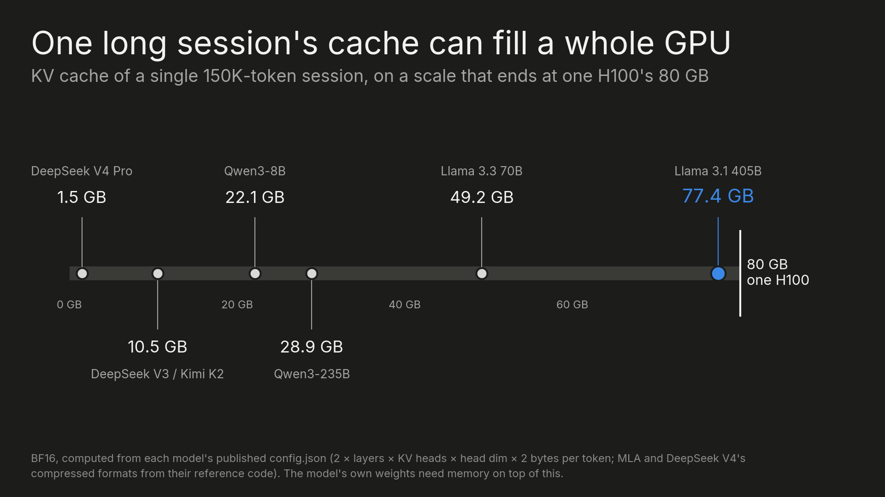

### 4 - A cache is born in GPU memory, but it can't stay there long

The cache is created where the model does its math: in GPU memory. On a gaming card that's called VRAM. Data-center GPUs use HBM, which is faster and much scarcer. An H100 has 80 GB. Nvidia's newest chips, B300 and Rubin, have 288 GB.

The memory is shared. The model's weights take a big share of it, and the rest has to serve everyone's requests. While your session sits idle, the GPU is busy with other people's work, and it needs the memory your cache is holding.

So old caches get deleted from GPU memory, least recently used first. I watched it happen by shrinking the cache pool on my H100 to about 71,000 tokens and opening eight 16K-token sessions, one after another:

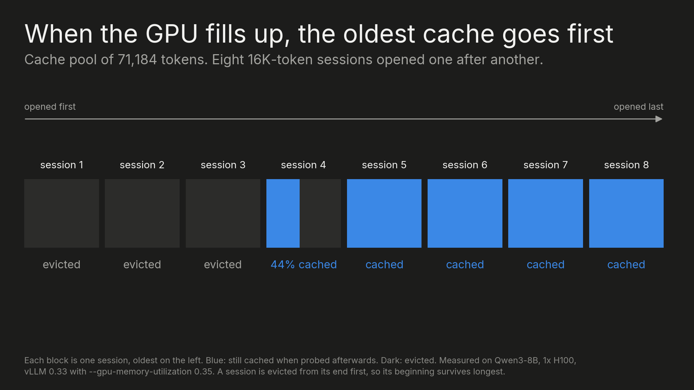

The four newest sessions were still fully cached, and the three oldest were gone. The one in between had lost its end but kept its beginning, because a session is evicted from its tail first.

Evicted doesn't have to mean deleted. Inference servers can copy the cache down to cheaper, bigger memory as it's created: the server's CPU memory, then local SSD, and in the biggest deployments a storage pool shared across machines.

When another request comes in, the cache can be moved back to the GPU. It's slower than having it stay on the GPU, but much faster than reading the prompt again:

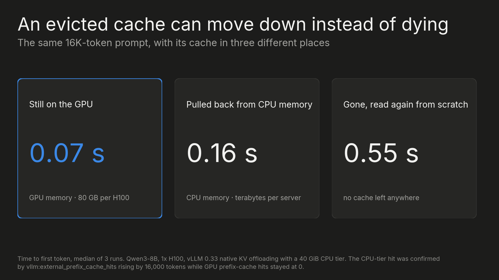

There's one more catch. A cache lives on a particular machine, and a provider runs thousands of them. If your next turn lands on a different one, it's a miss, even though your cache exists. OpenAI's docs say it plainly: cached states live on individual machines. Providers will try to route each conversation back to the machine that has its cache, unless that machine is too busy.

So a cache hit is not guaranteed. I ran two copies of the model side by side and sent the same 15 conversations through them three ways:

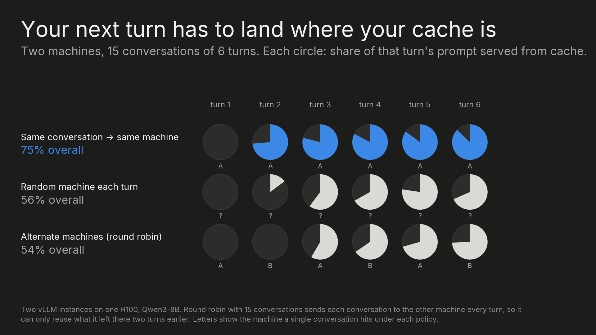

With a shared pool, any machine can fetch your cache, but it still has to pull it over first, so landing on the right machine is still faster.

### 5 - Guess: why Anthropic offers a 5-minute and a 1-hour cache

Anthropic sells two cache lifetimes, five minutes and an hour, and nothing in between.

The longer a cache sits on a device, the more it costs to keep, and at some point keeping it costs more than reading the prompt again. Every kind of memory has its own line of cost against time, and we can estimate its break-even point:

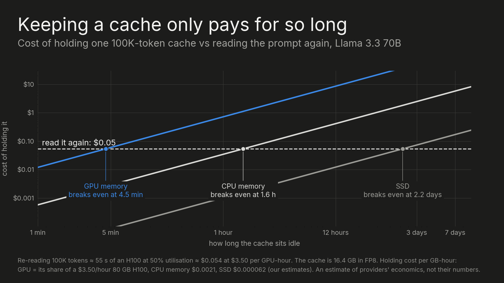

Now look at Anthropic's two options again. Five minutes is about as long as a cache is worth keeping on the GPU. An hour is far too long for the GPU, but fits comfortably in CPU memory. So when you pick an option, you're also telling Anthropic where your cache should live.

### 6 - Cache prices are copied, not calculated

On open models, a host's cache discount usually sits around what the model's maker charges on its own API. Most of Kimi K3's hosts charge 10% for a cache hit, the same as Moonshot. GLM's hosts sit around Z.ai's 19%, and DeepSeek's around DeepSeek's 2%.

But OpenAI doesn't sell gpt-oss-120b itself, so there's no maker's price to follow. Most of its hosts give no cache discount at all, even though caching works on it the same way it does on any other open model.

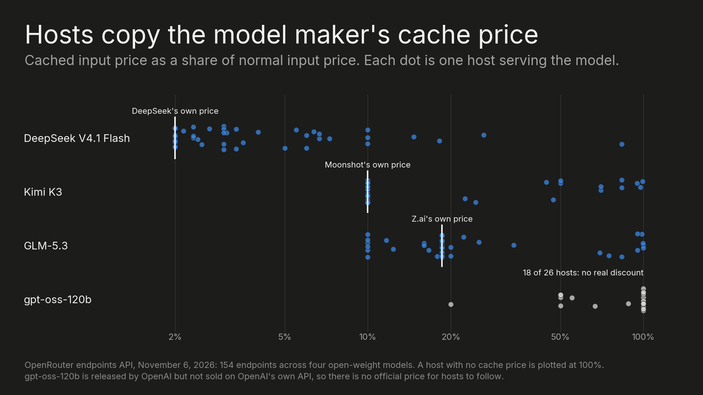

### 7 - Know what hit rate to expect

Every request is part old, part new. The old part, the history or instructions the provider has already seen, can come from the cache. The new part never can. So the best hit rate you can get depends on how much of each request is old, and that depends on what you're building.

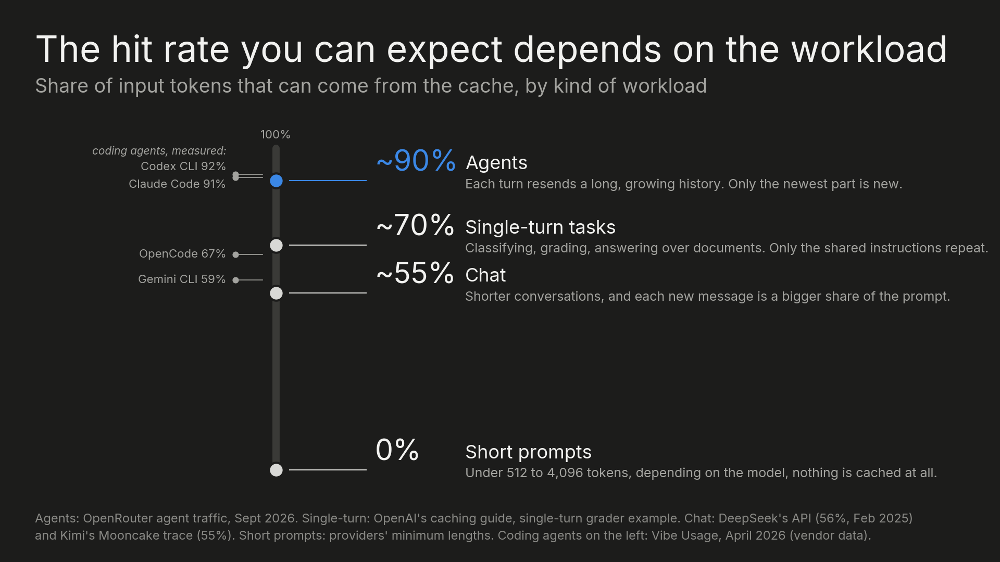

If you're well below what your kind of workload should get, something is breaking the cache. Anthropic and OpenAI now tell you what it was through their cache diagnostics.

### 8 - Keep the cache warm

Once reads cost 5% of input, writes become the expensive part. In a long coding session on Opus 5.5, writes are 60% of the bill.

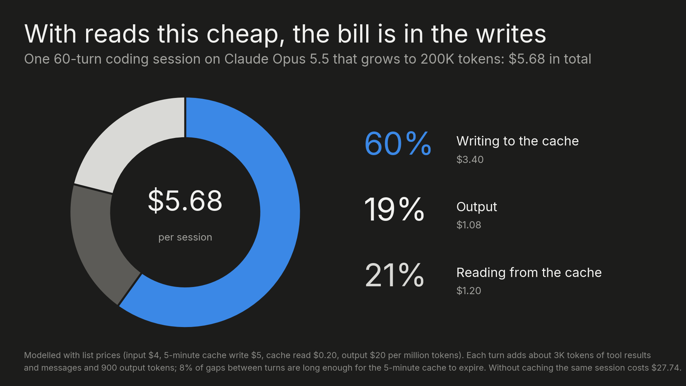

So the biggest lever is not letting the cache go cold. Come back after it has expired and the next message pays to write the whole history again. Pay for a longer cache lifetime if you need one.

### 9 - Check your harness, not just your prompt

Most cache misses I found weren't the user's fault. They were bugs in the harness, the tool that builds each request for you, like Claude Code, Codex or Cline. And they show up nowhere except the bill.

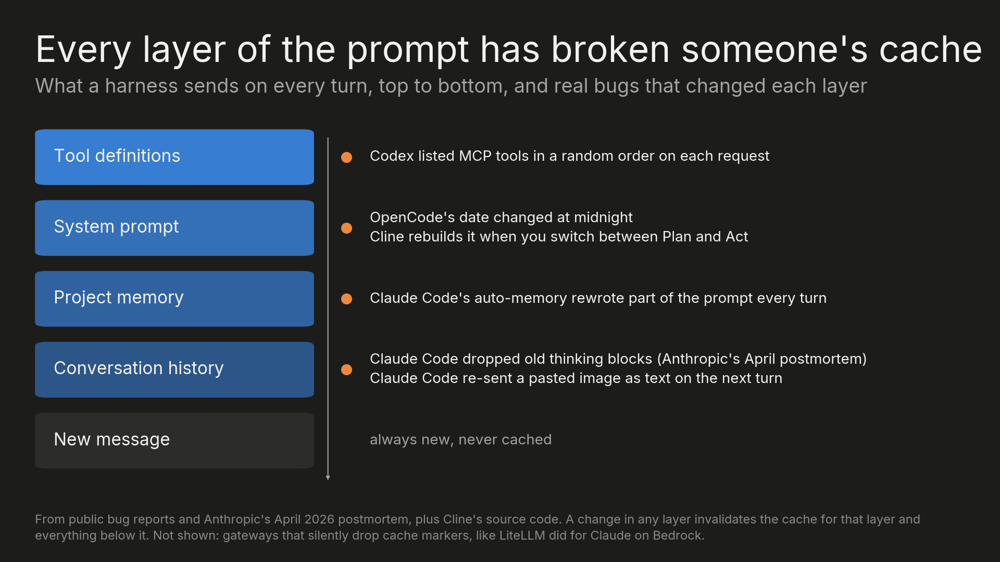

### 10 - Think twice before switching models

Switching models mid-session throws the cache away, because the cache belongs to one model. The new model has to read the whole history from scratch and pay to write it. That's how a cheaper model can make the next turn more expensive, and why it has to earn the switch back.

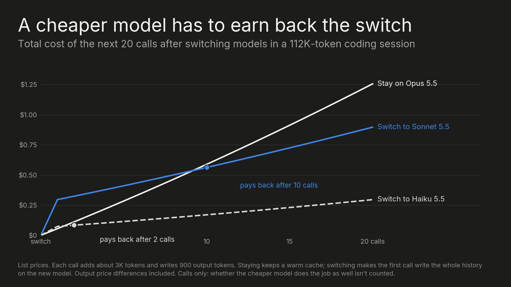

### 11 - Does your router count the cache?

A model router used to be pretty simple: pick the cheapest model that can finish the task. Caching makes it more complicated. The cheapest model for this request isn't always the cheapest for the session, because switching throws the cache away. A router has to understand the economics of caching, everything we've covered above, and pick the model on top of that. Most routers still don't:

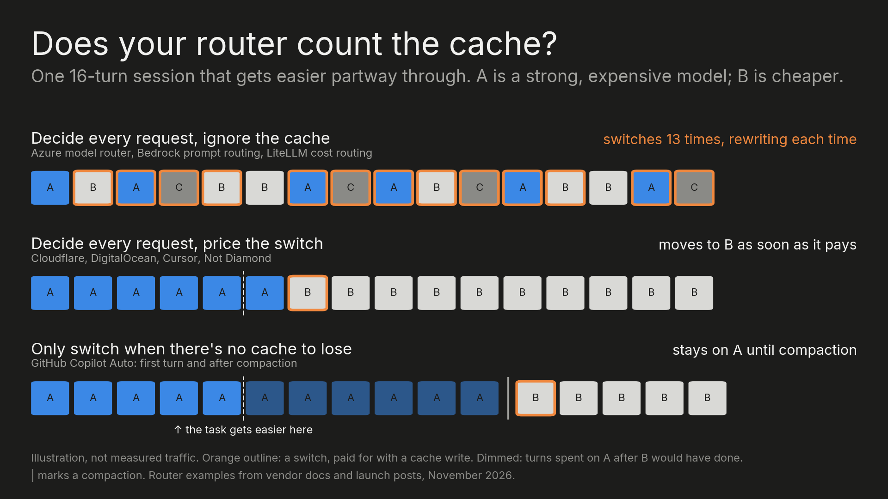

A cache-aware router needs to know three things. First, which conversation a request belongs to, so it can keep that conversation on one model instead of judging every request alone. Second, what a switch really costs: staying means reading the history at the cache price, moving means writing all of it again on the new model, and the saving only counts over the turns that are likely left. Third, each provider's cache rules: how long a cache lives and how reliably it hits, because a cache that has already expired costs nothing to leave.

That makes the best moments to switch easy to spot: at the start of a session, right after compaction, or once the cache has gone cold. Anywhere else, a switch has to pay for the cache it throws away.

---

*How I tested: the GPU experiments ran on one rented H100 (RunPod, about $2) with Qwen3-8B on vLLM 0.33. Session costs are modelled from published list prices as of November 2026. Host prices come from OpenRouter's public endpoints API on November 6, 2026. The GPU experiments, with scripts and raw results, are in [experiments](experiments/).*
